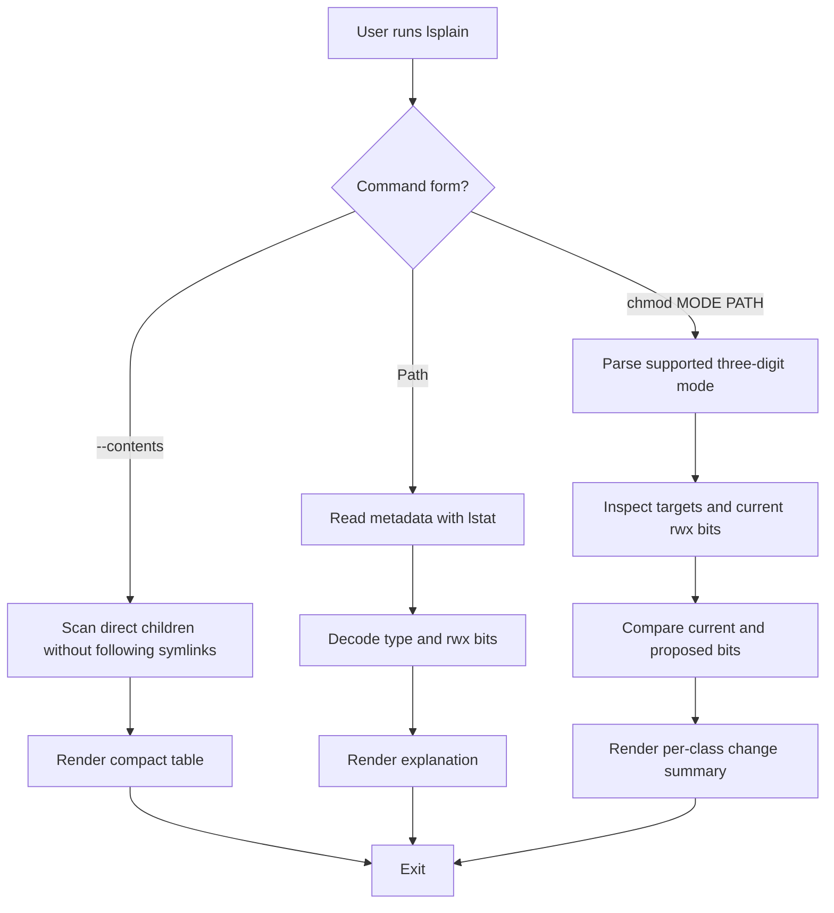

# lsplain

> `lsplain` — explains a file's Unix permissions in plain English and previews what a numeric `chmod` would change, without ever changing anything.

**Team:** Deeya Mathur, Ryane Bose
**Date:** 29-10-2026

---

## 1. The problem

### What we keep doing by hand

When we meet a permission string we do not recognise, or want to change one, we run this sequence:

```bash
ls -l ~/.zshrc
# copy "-rw-r--r--" into Google or an AI chat, read the answer, then:
chmod 755 notes.txt
ls -l notes.txt
```

`ls -l` shows `-rw-r--r--` but does not say what it allows. We copy the string into Google or an AI chat to decode it, work out which of owner/group/others applies to us, and after a `chmod` we run `ls -l` again to check we did what we meant. A mode like `755` is easy to misjudge: on a regular file it adds execute for the owner, the group **and** everybody else, not just the owner.

### Evidence that this is real

```bash
grep -cE '(^|;)ls[[:space:]]+-[[:alpha:]]*l[[:alpha:]]*([[:space:]]|$)' ~/.zsh_history
grep -cE '(^|;)stat[[:space:]]+' ~/.zsh_history
```

```
4
0
```

The first command counts saved `ls -l`-style commands (4); the second counts saved `stat` commands (0). We never use `stat` for this: the lookup happens in the browser or an AI chat, not in the terminal, which is why it does not show up in our history. Each time we hit an unfamiliar permission string it costs about 5 minutes on average to copy it into Google or an AI tool and read enough of the answer to understand it.

### Who else has this problem

We asked 5 classmates. All of them found permission strings hard to interpret and did not trust a `chmod` command without checking it first, so all 5 used Google or an AI tool to decode permissions.

---

## 2. Prior art — what already exists

### Tools we found and actually tried

| Tool | Where we found it | What it does | Why it does not solve our problem |
|---|---|---|---|
| macOS `ls -l` | Pre-installed | Lists metadata: mode string, link count, owner, group, size, date. | Shows `-rw-r--r--` but gives no interpretation of it. |
| [`eza`](https://github.com/eza-community/eza) | GitHub repository | Modern `ls` replacement; `eza -l --header -o -g -H` shows octal mode (`0644`), links, size, user, group, date. | Better structure, but still symbols and numbers; does not say what each class can do. |
| [`Choof`](https://github.com/elParadigm/choof) | GitHub repository | Terminal file browser; `p` explains current permissions (`User: read write`), `Ctrl+P` opens a permission editor. | Explains *current* permissions (so that part is not unique to us), but in the workflow we tested it did not explain a *proposed* `chmod` before applying it. |
| [`ch`](https://github.com/donmccaughey/ch) | GitHub repository | Changes file properties; `--dry-run -vv --mode 755 FILE` previews the change. | Closest overlap. Shows `mode 0100644 -> 0100755`, a technical diff, not who gains or loses what. |

### Evidence of trying them

We tested `ch` with a temporary file:

```bash
# Create a temporary directory
tmp=$(mktemp -d)

# Create a test file inside it
printf 'demo\n' > "$tmp/notes.txt"

# Set the starting permissions to 644
chmod 644 "$tmp/notes.txt"

# Preview changing the permissions from 644 to 755
./target/release/ch --dry-run -vv --mode 755 "$tmp/notes.txt"
```

**Output:**

```text
/var/folders/.../notes.txt: mode 0100644 -> 0100755
```

Then we checked whether the permissions actually changed:

```bash
# Check the file's current permissions
ls -l "$tmp/notes.txt"
```

```text
-rw-r--r--  1 ...  notes.txt
```

The file stayed at `0644`, so `--dry-run` worked. However, `ch` only showed the numeric change; it did not explain in plain English what permissions would change.

`ch` gets the safety right: it previews without applying (the final `ls -l` confirms the file is still `0644`) and reports old and new modes. What is missing, in the output we tested, is any statement of the practical effect — that owner, group and others would all gain execute. The reader still has to decode `0100644 -> 0100755` themselves. This describes the output we observed; it does not claim `ch` has no other features.

We also ran Choof on `~/.zshrc`. Pressing `p` printed `User : read write`, `Group : read`, `Others : read`. `Ctrl+P` opened a permission editor whose interface says Enter applies the selection; we changed nothing and the file stayed `0644`.

### Where we searched

- [x] `man -k permissions` — returned `group(5)`, curl `CURLOPT_NEW_*_PERMS`, `acl_*` and `archive_entry_*` pages; none explain file mode bits in plain English
- [x] GitHub search — found `eza`, `Choof` and `ch`
- [x] Homebrew: `brew search permission` — one result, `permify`, which is an application-authorization tool, not a file-permission explainer
- [x] Asked a human: 5 classmates — all used Google or AI to decode permissions

### The gap, in one sentence

"Existing tools can list permissions, explain current permission bits and preview a technical old-to-new mode change, but none of them explain in plain English what a proposed `chmod` would grant or revoke for owner, group and others, which is the part that actually costs us time."

---

## 3. What we are building

### In scope

- Explain a real file or directory's type, size, owner, group, timestamps and rwx bits in plain English.
- Show owner, group and others, and mark which class applies to the current user (effective UID and supplementary groups).
- Compact one-level directory listing with `--contents` (hidden entries only with `--all`).
- Preview three-digit numeric `chmod` modes (`000`–`777`) for one path or recursively with `-R`, without running `chmod`.
- Report rights gained or lost per class, plus conservative review warnings for some permission patterns.

### Out of scope

- Changing permissions or ownership — `lsplain` is read-only, so it cannot damage anything.
- Symbolic modes (`u+x`) and four-digit modes (`4755`) — they need extra parsing and special-bit logic; rejected with exit code 2 rather than guessed.
- ACLs, macOS privacy (TCC) decisions, filesystem flags — mode bits only; every output says so.
- Windows, a full security audit, JSON output, parsing pasted `ls -l` rows, a recursive directory browser — not needed for the problem we measured.

### How we will know it worked

"This tool is successful if it turns **3 commands plus a 5-minute browser/AI lookup** (`ls -l`, `chmod`, `ls -l` to verify) into **2 commands and no lookup** (`lsplain FILE` and `lsplain chmod MODE FILE`), and we actually use it after the assignment ends."

Automated checks: 12 `unittest` cases covering file explanation, hidden-file handling, preview not modifying the target, preview agreeing with a real `chmod` on a separate disposable file, recursive preview skipping symlinks, invalid modes, missing paths and grammar ("others gain").

---

## 4. Tech stack

| Choice | What we picked | Why, and what we rejected |
|---|---|---|
| Language | Python 3 | It is preinstalled on macOS, easy to read, and we are comfortable with it. Rejected pure bash: it would mean parsing `ls -l` text, which is fragile. |
| Argument parsing | `argparse` (stdlib) | Gives `--help`, usage errors and exit code 2 for free. Rejected hand-parsing `sys.argv` (more code, worse errors) and `click` (extra dependency). |
| Other dependencies | None — `os`, `stat`, `pwd`, `grp` | Reads metadata directly with `os.lstat`, so nothing to install. Rejected third-party libraries as unnecessary. |
| Testing | `unittest` (stdlib) | Runs with no install; tests use temporary directories. Rejected `pytest` to keep zero dependencies. |
| Packaging / install method | `install.sh` copying to `~/.local/bin` | One command, no root, easy to remove. Rejected `pip` packaging and a Homebrew formula as overkill for one script. |

### Why this language

Python is already on our Macs, it is easy to read, and we are comfortable using it out of habit, so we could spend our time on the permission logic rather than on the language. The standard library also already exposes everything we need (`os.lstat`, `stat`, `pwd`, `grp`), which kept us at zero dependencies.

### What we are deliberately not using

We did not write it in pure bash: decoding mode bits and user/group membership in shell means scraping `ls -l` output, which differs between systems and breaks on odd filenames. We also did not shell out to `chmod` at all, so the preview cannot change anything by accident.

---

## 5. Architecture



### Components

| Part | Responsibility | File |
|---|---|---|
| CLI / argument parser | Chooses path explanation, `--contents` listing, or `chmod` preview | `lsplain` |
| Metadata reader | Reads type, owner, group, size, timestamps, mode bits via `lstat` | `lsplain` |
| Permission explainer | Describes owner/group/others and which class applies to the current user | `lsplain` |
| Preview engine | Parses a three-digit mode, inspects paths, diffs current vs proposed bits; never runs `chmod` | `lsplain` |
| Renderer | Prints the explanation, compact listing or preview summary | `lsplain` |
| Tests | Exercise behaviour in temporary directories | `tests/test_lsplain.py` |
| Installer | Copies the script to `~/.local/bin` | `install.sh` |

### Data flow

The input is a path (or a path plus a proposed mode) from the command line. The tool reads metadata straight from the filesystem with `os.lstat`, decodes the mode bits per class, and for a preview compares them with the proposed bits. The output is plain text on stdout; errors go to stderr.

### What happens when things go wrong

| If this happens | The tool does this |
|---|---|
| Path does not exist or cannot be inspected | Prints `lsplain: cannot inspect '<path>': ...` to stderr, exits 1 |
| Mode is unsupported (`u+x`, `4755`, not 3 octal digits) | Prints an error naming the supported range, exits 2 |
| `-R` meets a symbolic link | Does not follow it; reports it as skipped |
| No path given / unknown option | argparse prints usage and exits 2 |

---

## 6. Usage

### Synopsis

```
lsplain [--verbose] <path> [<path> ...]
lsplain --contents [--all] <directory>
lsplain chmod [-R] <three-digit-mode> <path>
```

### Commands and flags

| Flag | Long form | What it does | Default |
|---|---|---|---|
| `-h` | `--help` | Show usage and exit | |
| | `--version` | Show version and exit | |
| `-v` | `--verbose` | Add numeric IDs, link count, inode, device, blocks | off |
| `-c` | `--contents` | Compact listing of a directory's immediate entries | off |
| `-a` | `--all` | With `--contents`, include hidden entries | off |
| `-R` | | In `chmod` form, inspect descendants recursively (symlinks not followed) | off |

There is no `--dry-run` flag: the `chmod` subcommand is **always** a preview and never runs `chmod`, so it is safe to run live.

### Examples

**Basic use**

```bash
$ lsplain notes.txt
```

```
notes.txt
  Type / size : regular file · 5 B
  Owner/group : deeyamathur (you) / wheel
  Permissions : 0644 (-rw-r--r--)
  Owner (you) : read, write/change contents
  Group       : read
  Others      : read
  Modified    : 2026-10-29 02:03:15 IST
  Access note : Mode bits only; ACLs, macOS privacy controls and other system rules may change actual access.
```

**With a flag / preview**

```bash
$ lsplain chmod 755 notes.txt
```

```
CHMOD PREVIEW — no permissions have been changed
  Proposed command : chmod 755 notes.txt (not executed)
  New rwx mode     : 755 (-rwxr-xr-x)
  Objects inspected: 1

  STATUS  CURRENT  ->  NEW     PATH
  CHANGE  0644       0755    notes.txt
           → owner gains execute permission
           → group gains execute permission
           → others gain execute permission

Summary: 1 object(s) would have different rwx bits; 0 already match.
Scope: predicts the three rwx triplets only; ACLs and other system controls are not simulated.
```

**When it fails**

```bash
$ lsplain chmod u+x notes.txt
```

```
usage: lsplain chmod [-h] [-R] mode path
lsplain chmod: error: MVP supports exactly 3 octal digits (000-777), for example 644, 755 or 000
```

```bash
$ lsplain nope.txt
```

```
lsplain: cannot inspect 'nope.txt': No such file or directory
```

### Exit codes

| Code | Meaning |
|---|---|
| 0 | Success |
| 1 | Path could not be inspected (e.g. does not exist) |
| 2 | Invalid usage or unsupported mode |

### Installation & Requirements

- Python 3.8 or newer
- macOS or Linux
- Git, if cloning the repository
- No third-party Python packages are required

**Platform note:** `lsplain` is designed for Unix-style file permissions and is currently intended for macOS and Linux. Windows is not supported.

```bash
git clone [https://github.com/mathur458/lsplain]
cd lsplain
./install.sh
```

If `lsplain` is not found after installation, add `~/.local/bin` to your PATH:

```bash
export PATH="$HOME/.local/bin:$PATH"
source ~/.zshrc
```

Verify the installation:

```bash
lsplain --version
```

---

## 7. References

- [eza manual](https://github.com/eza-community/eza/blob/main/man/eza.1.md) — metadata columns, headers, octal permissions
- [Choof](https://github.com/elParadigm/choof) — permission explainer (`p`) and permission changer (`Ctrl+P`); showed us the explainer part already exists
- [`ch`](https://github.com/donmccaughey/ch) — `--dry-run` with old/new mode output; the closest existing preview
- [Python `os.lstat`](https://docs.python.org/3/library/os.html#os.lstat) — metadata without following the final symlink
- [Python `stat` module](https://docs.python.org/3/library/stat.html) — file types and permission bits
- `man ls`, `man stat`, `man chmod` — local manual pages used to check mode semantics
